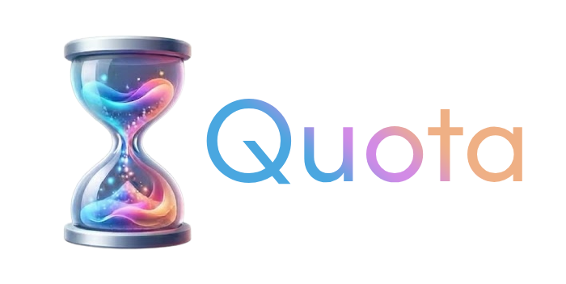

> How much of my remaining quota can I use each day until it renews?

Quota is a native macOS menu bar application that helps you manage the quotas of your AI subscriptions — one or several — so you never run out of allowance before the renewal date.

Most dashboards answer "how much have I used?". Quota answers the question that matters: given your subscriptions, what you have already consumed, and the time left until renewal, how much can you use each day?

---

## Who Quota is for

If you have one or more AI subscriptions and want to pace your daily usage to reach the end of the billing cycle without surprises, Quota is for you. It is useful if:

- You have a subscription with a monthly limit and want to know exactly how much you can use each day without running out before the month ends.
- You combine several subscriptions and need to track the usage of all of them in one place.
- You want to distribute usage intelligently, for example consuming more on weekdays and less on weekends.

## What Quota does

| Feature                             | What you get                                                                                                                                                |
| ----------------------------------- | ----------------------------------------------------------------------------------------------------------------------------------------------------------- |
| **Daily allowance in the menu bar** | See exactly how much you can use today for each subscription, without opening the app.                                                                      |
| **Automatic pacing**                | Quota calculates how much you can spend each remaining day until renewal, and recalculates automatically when a provider reports new usage. You do nothing. |
| **Multiple subscriptions**          | Manage all your providers and quotas from one window, each with its own renewal cycle and policy.                                                           |
| **Usage calendar**                  | Monthly view with a day-by-day plan, so you can see how your consumption is distributed throughout the month.                                               |
| **Custom policies**                 | Adjust the weight of each day of the week or define your own rules per subscription.                                                                        |
| **Hands-off updates**               | Quota reads the usage reported by each provider and updates the plan automatically.                                                                         |

## How it works

1. **Connect your providers.** Install the plugins for the services you use and configure each quota with its renewal date.
2. **Quota calculates your daily allowance.** It reads how much you have consumed and determines how much you can use each day until the next cycle.
3. **Check the menu bar every day.** Your daily allowance and the days you have left are there, at a glance.

## Requirements

- macOS 14 or later
- Apple Silicon or Intel Mac

## Installation

Download the latest version from the [releases page](https://github.com/enegalan/quota/releases):

1. Download the `.zip` for your Mac:

   - `arm64`: Apple Silicon (M1, M2, M3, M4)
   - `x86_64`: Intel

2. Unzip it and move `Quota.app` to `/Applications`.
3. Open it. If macOS blocks the app on first launch, go to **System Settings > Privacy & Security**, scroll down, and click **Open Anyway** next to Quota, then confirm.

## Privacy and security

- Your credentials are stored only in the macOS Keychain, never in a preferences file, a log line, or a diagnostic dump (Quota → Copy Diagnostic Dump).
- Quota has no backend, no account, and no cloud storage. Your usage data stays on your machine, except for the requests Quota makes to each provider itself.
- The application is deliberately not sandboxed because it needs to read a provider application's local state and make outbound network requests on your behalf. The entitlement set is kept to the minimum necessary.

## Changelog and releases

See the [changelog](CHANGELOG.md) and the [releases](https://github.com/enegalan/quota/releases) page for available versions and what each one includes.

---

### Development and plugins

Quota is open source. If you want to create a plugin for a new provider, build from source, or contribute, these are the requirements:

- Xcode 27 or later (Swift 6.3 toolchain)
- Homebrew (for the formatting and linting tools)

```sh
make bootstrap   # install swiftformat, swiftlint and prettier, once
make verify      # what CI runs: format check, lint, tests, plugins, bundle
make run         # build, bundle and launch
```
